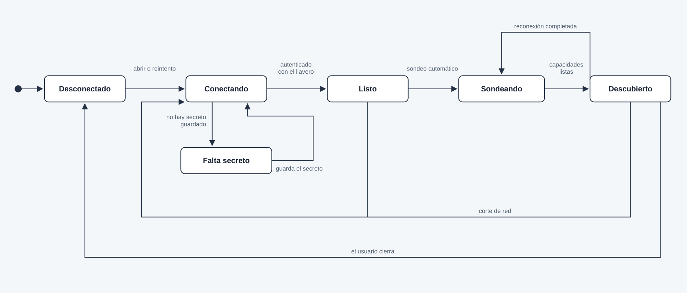

# Arquitectura de SSHuttle

SSHuttle es un cliente nativo que el operador instala en su máquina. No hay agente ni puerto extra en los servidores: todo pasa por SSH con el usuario que ya existe. La primera versión cubre consola, archivos, pods y paquetes del sistema.

El alta de un servidor pide solo **host, puerto, usuario y contraseña**. El puerto sale en 22. No hay pantallas para elegir gestor de paquetes, activar Kubernetes ni marcar si existe `tmux`. Al conectar, un sondeo de solo lectura descubre qué hay y la interfaz muestra únicamente eso.

Un asistente con modelo es opcional y viene apagado. Sirve para resolver dudas del servidor y para proponer tareas. Sin modelo, el resto de la app funciona igual.

El proyecto se distribuye bajo la licencia Apache 2.0, descrita en [LICENSE](../LICENSE).

## Decisiones

- **Un proceso local, cero agentes.** La app abre SSH, multiplexa canales y ejecuta ahí la consola, SFTP, `kubectl` y el gestor de paquetes.
- **Configuración mínima.** El perfil no guarda capacidades. Esas salen del sondeo en cada conexión y se refrescan al reconectar.
- **Tauri 2 + núcleo en Rust + UI en TypeScript (React).** Rust cubre SSH, el llavero y los instaladores. La misma UI sirve en escritorio e iOS. Librería SSH: `russh` y `russh-sftp` (Rust puro, compilable a iOS). No se usa `libssh2`.
- **Secretos fuera de la base.** Inventario en SQLite. Contraseñas SSH y API keys de modelos en el llavero del sistema (Credential Manager, Secret Service, Keychain). La reconexión lee el llavero y no vuelve a pedir credenciales.
- **Kubernetes v1 vía `kubectl` en el host SSH**, solo si el sondeo lo encuentra (nodo, bastión o caja de admin que ya tenga kubeconfig). La UI solo ofrece operaciones de una lista blanca. Un túnel al API de Kubernetes queda para después.
- **Actualizaciones v1: apt y dnf**, el que el sondeo detecte. Siempre hay vista previa y confirmación antes de aplicar. La salida se transmite en vivo. Si el gestor es otro (`pacman`, `zypper`, `apk`), se muestra como detectado y todavía no aplicable.
- **La consola sobrevive al corte si el sondeo encuentra `tmux`.** Al conectar, SSHuttle crea o adjunta una sesión `sshuttle`. Sin `tmux`, la SSH vuelve sola y abre una shell nueva.
- **El modelo no tiene shell libre.** Traduce una petición a una acción tipada de la misma lista blanca, o redacta una explicación. Toda mutación espera confirmación de la persona.

## Objetivos de instalación

- Windows: instalador NSIS/MSI.
- Linux: un `.deb` para Debian estable y Ubuntu LTS (dependencia de WebKitGTK), más AppImage para el resto, incluido CachyOS.
- iOS: `.ipa`. Hace falta macOS con Xcode para compilar y firmar. App Store o TestFlight, cuenta de Apple Developer.
- macOS de escritorio sale del mismo target de Tauri, sin ser un objetivo distinto de v1.

En iOS el sistema suspende la app en segundo plano. La reconexión infinita vale con la app en primer plano o al volver a ella; no hay un demonio siempre activo.

## Capas

El supervisor mantiene **una conexión SSH por perfil** y abre canales encima (PTY, SFTP, exec). Keepalive periódico. Si el socket cae, reintenta con espera creciente hasta un tope de 30 segundos, autenticando solo con el llavero.

La consola queda usable en cuanto la SSH está autenticada. El sondeo corre en paralelo y va encendiendo archivos, actualizaciones y pods. Estados visibles: desconectado, conectando, listo, sondeando, descubierto, falta secreto. Un corte a mitad de `apt` o de un log no se reanuda a ciegas: al volver la conexión, la operación queda marcada como interrumpida y el usuario la relanza. El sondeo se vuelve a correr solo.

## Sondeo automático

Al quedar la sesión lista, y otra vez después de cada reconexión, SSHuttle ejecuta un conjunto fijo de comandos de solo lectura, en paralelo y con tope de tiempo. No hay scripts definidos por el usuario.

- Sistema: `/etc/os-release`, `uname`, hostname, `id` y home.
- Herramientas: presencia de `apt`, `dnf`, `kubectl` y `tmux`.
- Paquetes: si hay `apt` o `dnf`, el gestor queda elegido. El listado completo de actualizaciones se pide cuando se abre esa pantalla, no durante el alta.
- Kubernetes: si hay `kubectl`, contexto actual y si responde el cluster. El listado de pods se carga en su pantalla.
- Archivos: prueba del subsistema SFTP. Si responde, aparece el gestor de archivos.
- Otros gestores (`pacman`, `zypper`, `apk`) se anotan para mostrarlos, sin ofrecer aplicar.

El resultado es un conjunto de capacidades, no una configuración:

- Consola, siempre. `tmux` sí o no.
- Archivos, si SFTP respondió.
- Actualizaciones, con el gestor detectado o vacío.
- Pods, con el contexto de `kubectl` o ausente.

La UI no muestra secciones vacías por configurar: oculta lo que no está y, si hace falta, dice que en ese servidor no apareció `kubectl` o un gestor soportado. El último sondeo se guarda en SQLite para pintar rápido al reabrir; queda marcado como viejo hasta que el sondeo nuevo termina. Ahí no se guardan secretos ni kubeconfig.

## Módulos

- **Inventario.** Perfil: nombre visible, host, puerto, usuario y referencia al secreto. Nada de flags de kube, gestor ni saltos. El nombre visible puede precargarse con el host. SQLite local.
- **Llavero.** Contraseña SSH y, si se usa, la API key del modelo. La base guarda el id, nunca el secreto. La primera conexión pide la contraseña una vez y la guarda para las reconexiones. Una clave SSH puede sustituir a la contraseña en el mismo formulario; no agrega un asistente de configuración. El agent de SSH, en escritorio, es otra alternativa del mismo campo.
- **Identidad del host.** Trust on first use. Si la huella cambia, se corta la conexión y se pide confirmación. No se acepta el host nuevo en silencio.
- **Consola.** Canal PTY, tamaño sincronizado con xterm.js. Sesión `tmux` llamada `sshuttle` cuando el sondeo encontró el binario. La reconexión no pide usuario ni contraseña.
- **Archivos.** SFTP sobre la misma conexión, si el sondeo lo habilitó: listar, subir, bajar, renombrar, mkdir, borrar. Edición de texto solo bajo un tope de tamaño (bajar, editar, subir).
- **Pods.** Solo si el sondeo encontró `kubectl`. Operaciones permitidas: listar pods en JSON, logs en vivo, reiniciar (borrar el pod) y exec, que reutiliza la consola. Nada de shell libre disfrazado de acción de Kubernetes. Borrar un pod pide confirmación.
- **Actualizaciones.** Solo el gestor que el sondeo eligió entre `apt` y `dnf`. Vista previa (`apt list --upgradable` o `dnf check-update`) y, tras confirmar, aplicar transmitiendo stdout/stderr. Sin aplicación desatendida.
- **Asistente.** Opcional. Ver la sección siguiente.
- **Auditoría local.** Cada reinicio de pod, cada actualización y cada acción disparada por el asistente queda en SQLite: perfil, acción, hora, resultado, si la confirmó una persona. Sin secretos en ese registro.

## Asistente

Apagado hasta que la persona elige un proveedor. La app no incluye un modelo embebido.

Dos tipos de proveedor, un solo cliente compatible con la API de OpenAI:

- **Local.** URL y nombre de modelo. Cubre Ollama, LM Studio o `llama.cpp` en la misma máquina. El contexto del servidor no sale de la red local. Es la opción por defecto cuando se enciende el asistente.
- **API key.** URL, modelo y clave guardada en el llavero. La UI avisa que el contexto de esa conversación sale de la máquina hacia ese proveedor.

Dos usos sobre el mismo chat:

- **Dudas.** Explica lo que ya se ve: resumen del sondeo, log de un pod, vista previa de paquetes, extracto de un archivo abierto o selección de la consola. No ejecuta nada.
- **Tareas.** La frase de la persona se convierte en una acción tipada (`listar pods`, `ver logs`, `vista previa de paquetes`, `aplicar actualizaciones`, `reiniciar pod`, `abrir ruta`). El núcleo valida el tipo y los argumentos contra la lista blanca. Si el tipo no existe, se rechaza. Las lecturas se ejecutan y la respuesta vuelve al chat. Borrar un pod, aplicar paquetes o escribir en la consola muestran la acción y esperan confirmación.

El modelo no recibe contraseñas, claves privadas, kubeconfig ni el tráfico SSH. Recibe el resumen del sondeo y el recorte de la pantalla en la que está la persona, con tope de tamaño. No hay un canal para que el modelo invente un comando y se ejecute solo.

## Estructura del repo

- `src-tauri/` — shell Tauri, comandos IPC, empaquetado.
- `crates/ssh/` — supervisor, keepalive, reconexión.
- `crates/vault/` — llavero por sistema, SSH y API keys.
- `crates/inventory/` — SQLite, perfiles y último sondeo.
- `crates/discover/` — comandos fijos de sondeo y conjunto de capacidades.
- `crates/terminal/` — PTY y tmux.
- `crates/files/` — SFTP.
- `crates/updates/` — apt y dnf.
- `crates/kube/` — lista blanca de kubectl.
- `crates/assistant/` — proveedores, recorte de contexto y acciones tipadas.
- `ui/` — React: barra vertical de fichas (iniciales y punto de estado) con casillero de alta, consola, y pantallas que aparecen según el sondeo.
- `docs/arquitectura.md` — este diseño.

Los crates de capacidades no abren sockets: reciben un handle del supervisor. El asistente no habla SSH: llama a esos crates. Así la reconexión, el sondeo y las credenciales viven en un solo lugar.

Las pruebas no comparten archivo con la implementación. Cada módulo deja su conducta en su archivo y las pruebas en otro, al lado: `indicador.rs` y `indicador_pruebas.rs`. Ese archivo se compila solo al correr `cargo test` y puede usar funciones internas del módulo. Lo que prueba la API pública del crate va en `crates/<crate>/tests/`.

## Empaquetado y seguridad

- El `.deb` declara la dependencia de WebKitGTK y apunta a Debian estable y Ubuntu LTS. AppImage lleva el runtime para no depender del sistema.
- Confirmación explícita antes de actualizar paquetes, borrar un pod o aceptar una acción mutable del asistente.
- Los logs de la app no imprimen contraseñas, frases de clave, API keys ni kubeconfig.
- La lista blanca de kubectl y la del asistente arman los argumentos en código; no concatenan una cadena de shell que venga de la UI o del modelo.
- El sondeo solo corre comandos fijos de lectura. Un servidor malicioso puede mentir en esa salida; no puede hacer que la app ejecute otra cosa distinta de la lista blanca.

## Fases de implementación

1. Inventario mínimo, llavero y supervisor con reconexión.
2. Sondeo automático y UI que muestra solo las capacidades halladas.
3. Consola y tmux.
4. Archivos SFTP.
5. Actualizaciones apt/dnf.
6. Pods.
7. Asistente local y por API key.
8. Instaladores Windows, `.deb`, AppImage e iOS.

Queda fuera de v1: agente en el servidor, túnel al API de Kubernetes, aplicar `pacman`/`zypper`/`apk`, salto `ProxyJump`, Android, actualizaciones desatendidas y un modelo embebido en la app.
